<div align="center">

# Card Fraud Triage with Gaussian Mixture Models

**Finding the needle in 57,000 transactions, without ever being shown a needle.**


-2E7D32)


Team T011 · Section A · Project 26 · ML/DL Course Project

</div>

---

## The problem in one picture

Out of every **1,000** card transactions in this dataset, fewer than **2** are fraud. A bank can't check them all by hand. So we asked a simpler question:

> **If an analyst can only check a few transactions today, which ones should they check first?**

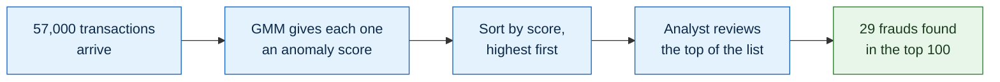

The interesting part is that the model **never sees a single fraud during training**. It only learns what *normal* spending looks like, and anything that doesn't fit gets a high score.

---

## Results at a glance

<table>
<tr>
<td align="center" width="25%"><h2>37 / 74</h2>frauds caught<br/>at the default cutoff</td>
<td align="center" width="25%"><h2>29</h2>frauds in the<br/>top 100 alerts</td>
<td align="center" width="25%"><h2>0.30%</h2>of legitimate users<br/>wrongly flagged</td>
<td align="center" width="25%"><h2>~3×</h2>better ranking than<br/>a single Gaussian</td>
</tr>
</table>

| Metric (test period) | Value |
|---|---|
| Transactions tested | 56,746 (74 frauds) |
| Recall at default cutoff | **50.0%** |
| Precision at default cutoff | 17.7% |
| PR AUC: our 8-component GMM | **0.1496** |
| PR AUC: 1-Gaussian baseline | 0.0527 |

Picking 100 transactions at random would find about **0.13** frauds. Our top 100 has **29**.

> These numbers come from our time-based split. They show how the method behaves here, not how it would perform inside a real bank.

---

## How a GMM spots fraud

Normal spending isn't just one pattern. Some people buy coffee, some pay rent, some shop online at midnight. One bell curve can't describe all of that, but a **mixture** of several bell curves can.

<p align="center">
  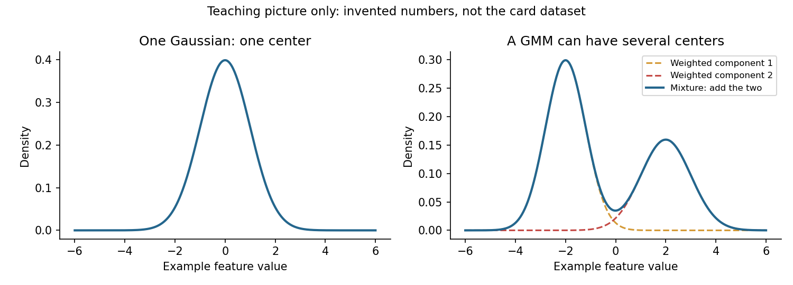
</p>

<p align="center"><i>A single Gaussian (blue) puts its peak where almost no data lives. A mixture (orange) can follow several groups at once.</i></p>

Our model uses **8** of these bell curves across 29 features. To score a new transaction:

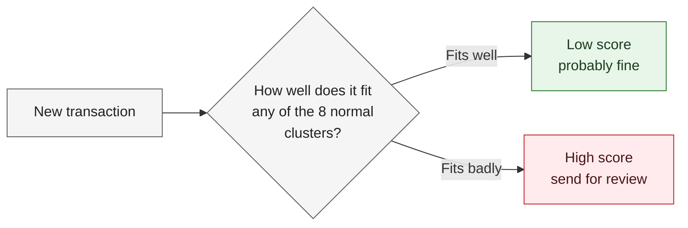

In maths, the score is just the negative log-likelihood:

$$\text{score}(x) = -\log p(x) \quad\text{where}\quad p(x) = \sum_{k=1}^{8} \pi_k \, \mathcal{N}(x \mid \mu_k, \Sigma_k)$$

Each cluster has a weight $\pi_k$, a centre $\mu_k$ and a spread $\Sigma_k$. The **EM algorithm** learns all of them from the legitimate training data.

---

## The full pipeline

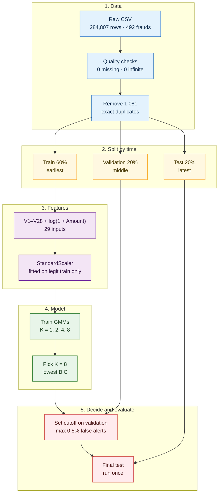

Here's what happens at each step.

### 1. Data

We use the [Credit Card Fraud Detection dataset](https://www.kaggle.com/datasets/mlg-ulb/creditcardfraud) from ULB / Worldline: two days of European card transactions.

| Column | Meaning |
|---|---|
| `V1` – `V28` | Anonymised PCA features (the bank hides the original columns) |
| `Amount` | Transaction amount in EUR |
| `Time` | Seconds since the first transaction |
| `Class` | 0 = legitimate, 1 = fraud |

<p align="center">
  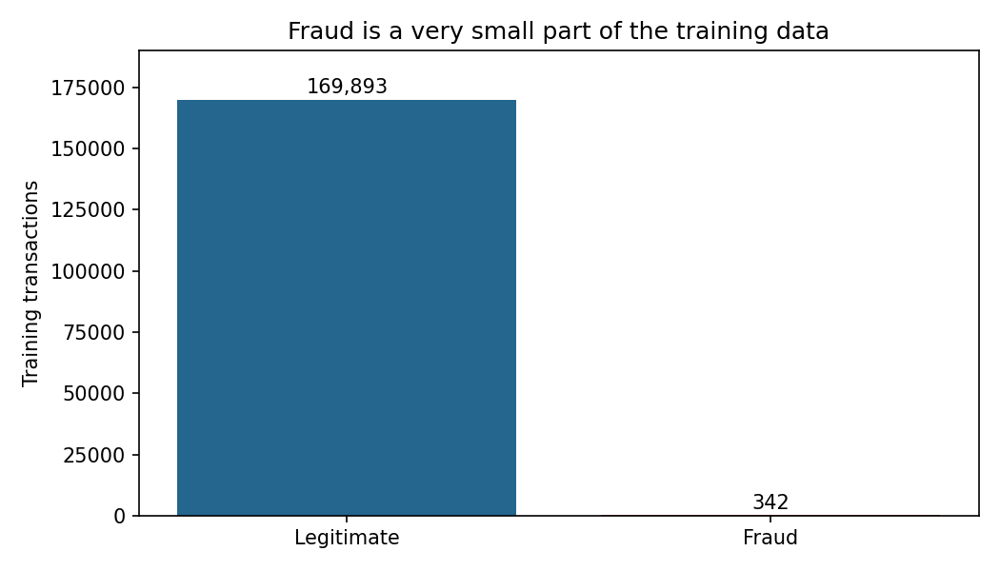
</p>
<p align="center"><i>Fraud makes up only about 0.17% of all transactions. This is why accuracy is useless here: a model that always says "not fraud" would be 99.8% accurate.</i></p>

### 2. Split by time, not randomly

In real life a model is trained on the past and used on the future. A random split would let the model peek at later transactions, so we split in time order.

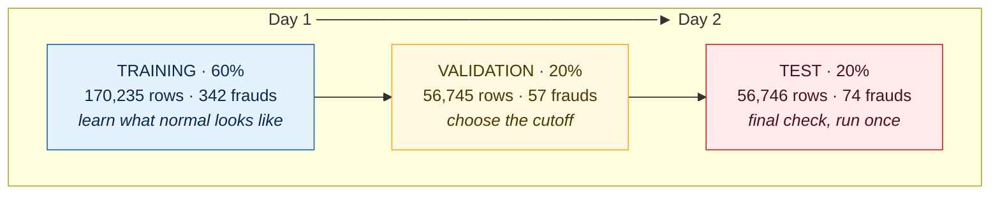

Only the **legitimate** rows from training (169,893 of them) are used to fit the model.

### 3. Feature engineering

Transaction amounts are heavily skewed: most are small and a few are huge. Taking `log(1 + Amount)` spreads them out into a much friendlier shape.

<p align="center">
  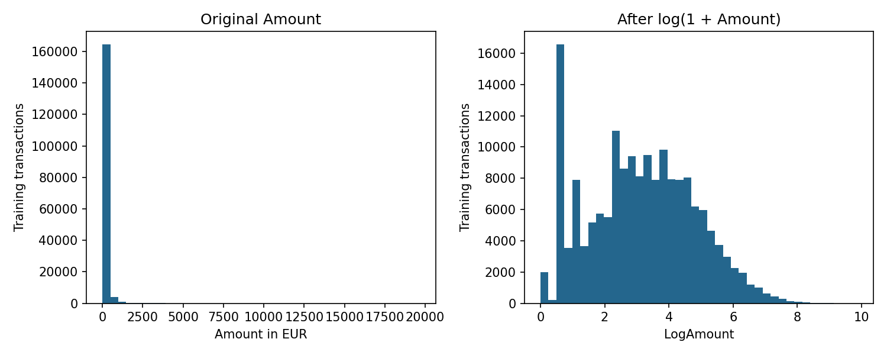
</p>

Final inputs: **`V1`–`V28` + `LogAmount` = 29 features.** We leave `Time` out on purpose, because "seconds since the start of the file" means nothing for a new transaction.

The `StandardScaler` is fitted **only on legitimate training rows**, then reused as-is for validation and test, so nothing leaks in from the future.

### 4. Training and choosing K

We trained four GMMs with diagonal covariance and 3 random restarts each. All four converged. We picked the one with the lowest **BIC** (Bayesian Information Criterion), which rewards a good fit but punishes extra complexity.

<p align="center">
  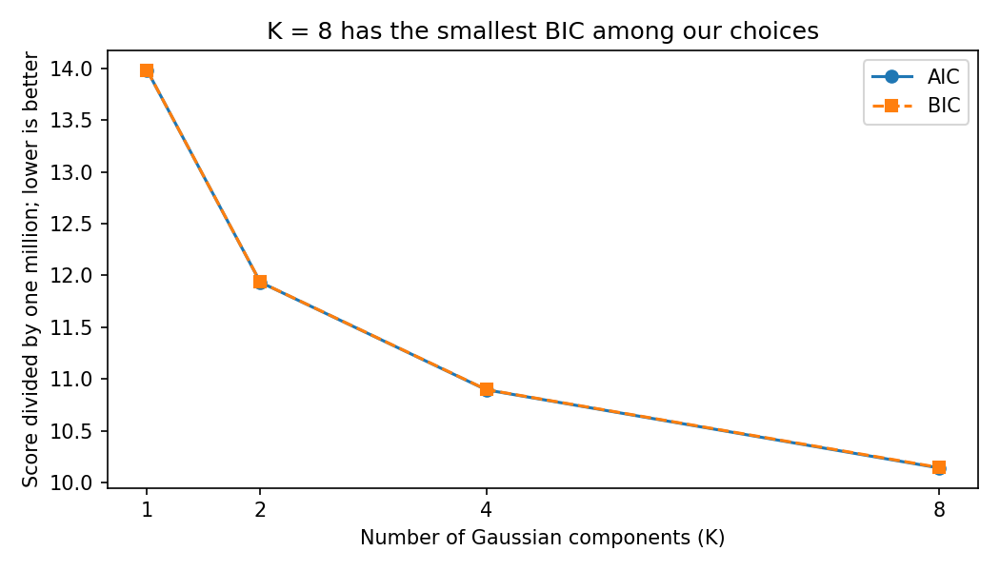
</p>

| K | BIC | EM iterations |
|---|---|---|
| 1 | 13,982,626 | 2 |
| 2 | 11,936,015 | 9 |
| 4 | 10,896,761 | 32 |
| **8** | **10,144,915** | 35 |

### 5. Picking the cutoff and testing

A score alone doesn't make a decision; you also need a cutoff. We chose it on **validation** data, *before* looking at test, by asking: *"what score keeps false alerts at or below 0.5% of legitimate transactions?"*

Then we ran the test set **once**.

<p align="center">
  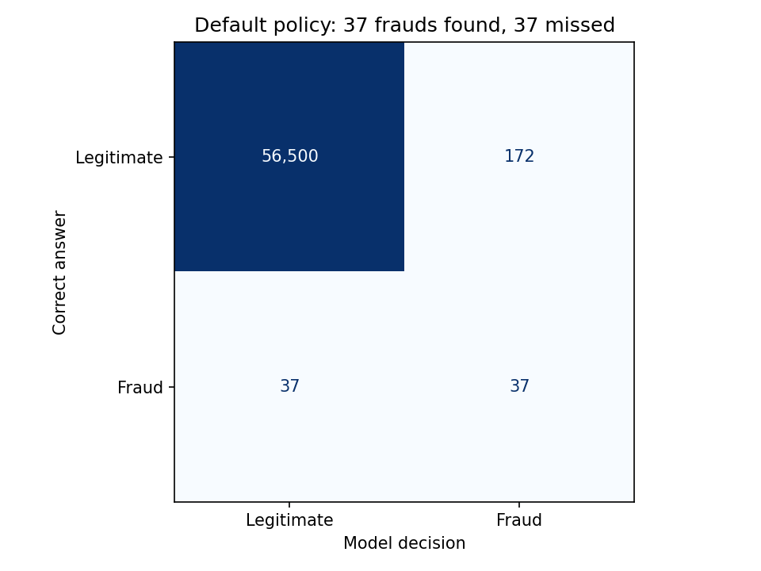
</p>

|  | Predicted legit | Predicted fraud |
|---|---|---|
| **Actually legit** | 56,500 | 172 (false alert) |
| **Actually fraud** | 37 (missed) | **37 (caught)** |

---

## The trade-off: how many alerts can you handle?

There's no single "right" cutoff. A stricter one means fewer false alerts but more missed fraud, so it depends on how many cases the fraud team can review.

<p align="center">
  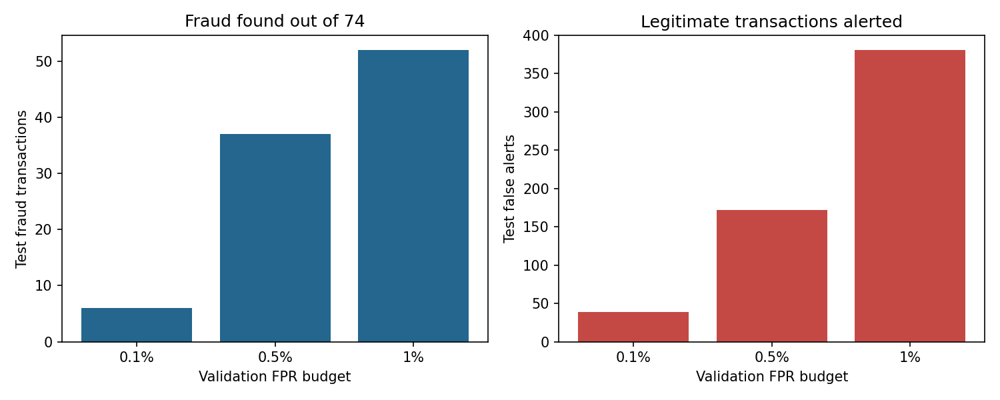
</p>

| Alert budget | Frauds found | False alerts | Recall | Precision |
|---|---|---|---|---|
| 0.1% (strict) | 6 | 39 | 8.1% | 13.3% |
| **0.5% (default)** | **37** | **172** | **50.0%** | **17.7%** |
| 1.0% (relaxed) | 52 | 381 | 70.3% | 12.0% |

Another way to look at it: *"if my team can review N cases, how many frauds do they find?"*

| Cases reviewed | Frauds found | Hit rate |
|---|---|---|
| 50 | 8 | 16.0% |
| **100** | **29** | **29.0%** |
| 200 | 37 | 18.5% |
| 500 | 53 | 10.6% |

<p align="center">
  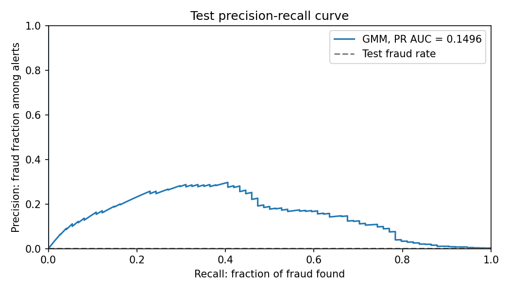
</p>
<p align="center"><i>We use the precision-recall curve instead of ROC because, with this much imbalance, ROC looks good even for weak models.</i></p>

---

## Why not just train a classifier?

| | Supervised classifier | Our GMM approach |
|---|---|---|
| Needs fraud labels to train | Yes, lots of them | **No**, only normal data |
| Fraud examples available | Only 342 in training | Doesn't matter |
| New fraud patterns | Can miss them | Flags anything unusual |
| Easy to explain | Often a black box | "This doesn't look like normal spending" |

## Limitations

- **Only two days of data**, so we can't test how the model ages over weeks or months.
- **Anonymised features** mean we can't explain *why* something looks suspicious in business terms.
- **Scores overlap.** Half of the test frauds score below the default cutoff:

<p align="center">
  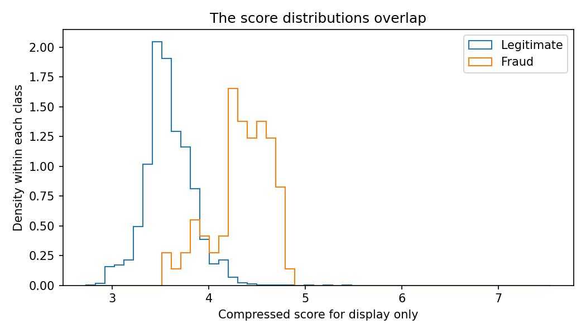
</p>

- **Diagonal covariance** ignores correlations between features. We chose it for speed and stability.

## Coming in Phase 2

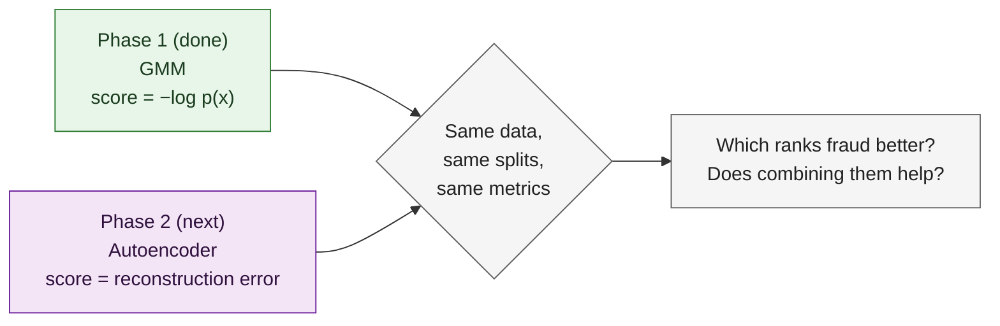

---

## Project structure

```
t011-card-fraud-phase1/
├── notebooks/            # All the code: 5 notebooks, run in order
├── results/              # Saved metrics and settings (CSV / JSON)
├── figures/              # Every chart in this README
├── report/               # IEEE-format LaTeX report source
├── output/               # Final PDF report, slides, HTML notebook copies
├── docs/                 # Literature review, viva guide, checklist, team record
├── data/                 # Dataset notes (CSV downloads automatically)
├── index.html            # Read the notebooks in a browser
├── FILE_MAP.md           # Which notebook creates which file
├── STUDY_GUIDE.md        # Concepts explained for revision
└── requirements.txt
```

| # | Notebook | What happens |
|---|---|---|
| 01 | [Project and Literature](notebooks/01_Project_and_Literature.ipynb) | Problem, related work, design decisions (reading only) |
| 02 | [Data Quality and EDA](notebooks/02_Data_Quality_and_EDA.ipynb) | Load, check, de-duplicate, split by time, explore |
| 03 | [Feature Engineering](notebooks/03_Feature_Engineering.ipynb) | Build 29 features, fit the scaler |
| 04 | [GMM Training](notebooks/04_GMM_Training.ipynb) | Explain EM, train K = 1/2/4/8, choose by BIC |
| 05 | [Evaluation and Thresholds](notebooks/05_Evaluation_and_Thresholds.ipynb) | Cutoffs, test results, PR curve, review capacity |

Each notebook saves its outputs and the next one loads them, so you don't need one long Python session.

---

## Run it yourself

You need **Python 3.12**.

```bash
git clone https://github.com/mitul-bhatia/t011-card-fraud-phase1.git
cd t011-card-fraud-phase1

python -m venv .venv
source .venv/bin/activate        # Windows: .venv\Scripts\activate

pip install -r requirements.txt
```

Then open `notebooks/` in Jupyter or VS Code:

1. Read **01**.
2. Open **02**, pick your Python environment, and click **Restart & Run All**.
3. When it finishes, do the same for **03 → 04 → 05**.

The dataset downloads itself the first time notebook 02 runs. With seed `42` you should get the same numbers shown here.

> **Just want to read?** Open [index.html](index.html) in a browser. All five notebooks are there with outputs included.

---

## Deliverables

| | |
|---|---|
| Report (IEEE format) | [PDF](output/Phase1_Report.pdf) · [LaTeX source](report/Phase1_Report.tex) |
| Presentation | [PPTX](output/Phase1_Presentation_Complete.pptx) · [PDF](output/Phase1_Presentation_Complete.pdf) |
| Literature review | [docs/LITERATURE_REVIEW.md](docs/LITERATURE_REVIEW.md) |
| Viva and demo prep | [Demo guide](docs/DEMO_AND_VIVA.md) · [Study guide](STUDY_GUIDE.md) |
| Phase 1 checklist | [docs/PHASE1_CHECKLIST.md](docs/PHASE1_CHECKLIST.md) |

## Team T011

| Enrollment No. | Name |
|---|---|
| 2401010174 | H Maheshwari |
| 2401010486 | Vaibhav |
| 2401010267 | Mayank |
| 2401010222 | Keshav |
| 2401010279 | Mitul Bhatia |

Who did what: [docs/TEAM_CONTRIBUTIONS.md](docs/TEAM_CONTRIBUTIONS.md)

## References

- Dempster, Laird and Rubin (1977), *Maximum Likelihood from Incomplete Data via the EM Algorithm*, JRSS-B. [DOI](https://doi.org/10.1111/j.2517-6161.1977.tb01600.x)
- Saito and Rehmsmeier (2015), *The Precision-Recall Plot Is More Informative than the ROC Plot on Imbalanced Datasets*, PLOS ONE. [Paper](https://journals.plos.org/plosone/article?id=10.1371/journal.pone.0118432)
- scikit-learn: [Gaussian Mixture Models](https://scikit-learn.org/stable/modules/mixture.html)
- ULB Machine Learning Group / Worldline: [Credit Card Fraud Detection dataset](https://www.kaggle.com/datasets/mlg-ulb/creditcardfraud)

More detail is in the [literature review](docs/LITERATURE_REVIEW.md).
