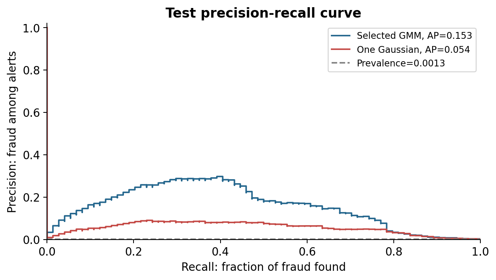
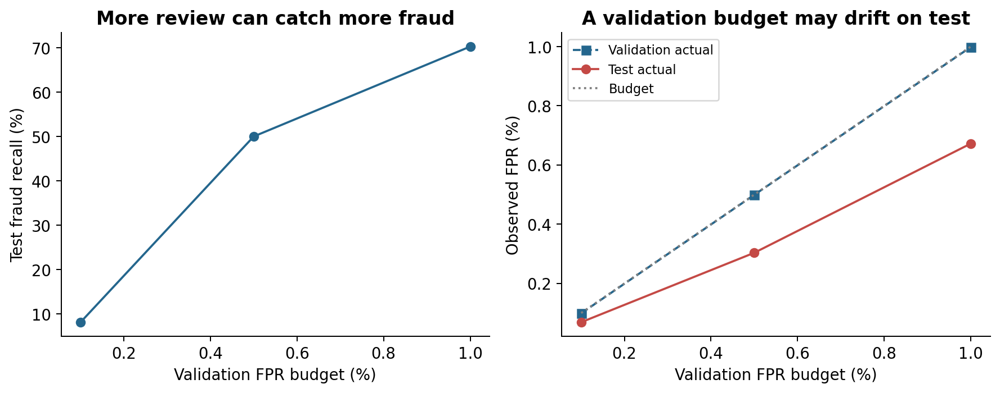

# Card Fraud Triage - Phase 1

**Team T011, Section A, Project 26**  
Newton School of Technology, Rishihood University

Learn normal transaction patterns with a Gaussian Mixture Model (GMM), then send unusual transactions for human review. **This submission implements the machine-learning phase only.** The autoencoder comparison remains Phase 2 work.

## Start here

1. Open [the executed notebook](notebooks/phase1_gmm.ipynb), or its [HTML study copy](output/phase1_notebook.html). Follow the numbered sections from top to bottom.
2. Read [the study guide](docs/STUDY_GUIDE.md). It explains every choice, formula and chart.
3. Read the [IEEE report](output/phase1_report.pdf) and use the [presentation](output/phase1_presentation_final.pptx).
4. Follow [the demonstration guide](docs/DEMO_AND_PRESENTATION.md) to rehearse. Each member should answer the viva questions individually.

A [PDF copy of the slides](output/phase1_presentation_final.pdf) is also available for easy viewing.

## Actual results

The original CSV contains 284,807 transactions and 492 frauds. Removing 1,081 exact repeated rows leaves 283,726 rows and 473 frauds. We keep the earliest occurrence of an exact row, a documented cleaning assumption because transaction IDs are unavailable.

| Split | Rows | Legitimate | Fraud |
|---|---:|---:|---:|
| Earlier training period | 170,235 | 169,893 | 342 |
| Validation period | 56,745 | 56,688 | 57 |
| Later test period | 56,746 | 56,672 | 74 |

The scaler and GMM learn from **169,893 legitimate training transactions**. Neither sees the 342 training frauds. We test K=1,2,4,8 and select K=8 by minimum training BIC. All four candidates converge. K=8 is the best tested value, not proof of a globally optimal component count.

| Test ranking measure | Selected GMM | One Gaussian reference |
|---|---:|---:|
| Average precision (AP) | 0.1532 | 0.0540 |
| Trapezoidal PR AUC | 0.1496 | 0.0527 |

Test fraud prevalence is 0.1304%. AP and trapezoidal PR AUC use different integration conventions, so we label both explicitly. Neither is accuracy or precision at one threshold.

| Validation FPR budget | Test fraud found | Test false alerts | Test recall | Test precision | Test actual FPR |
|---|---:|---:|---:|---:|---:|
| 0.1% | 6 / 74 | 39 | 8.11% | 13.33% | 0.0688% |
| 0.5% | 37 / 74 | 172 | 50.00% | 17.70% | 0.3035% |
| 1.0% | 52 / 74 | 381 | 70.27% | 12.01% | 0.6723% |

The illustrative default is the **0.5% validation FPR budget**, fixed before test evaluation. It creates 209 test alerts: 37 frauds and 172 legitimate transactions. It misses 37 frauds. The threshold is 75.8942, with `anomaly_score > threshold`. The validation budget does not guarantee the same test FPR.

Reviewing exactly the top 100 scores in this test batch finds 29 frauds (**precision@100 = 29%**). This is a fixed batch capacity, not a claim about a daily live queue. Precision@K can rise or fall as K changes.





## Run it

Python 3.12 is recommended. These commands work from this folder:

```bash
python3 -m venv .venv
source .venv/bin/activate
python -m pip install -r requirements.txt
python scripts/download_data.py
python scripts/run_phase1.py
python -m unittest discover -s tests -v
```

For the notebook, open `notebooks/phase1_gmm.ipynb` in VS Code or Jupyter and select this Python environment. Run all cells in order. The delivered notebook already includes actual outputs and charts. Its first cell finds the project root when launched from either the root or `notebooks/`.

Training took about 12 seconds across the four candidates on the preparation machine. Import time, plotting time, and your hardware can change total runtime. No GPU or deep-learning package is required.

The one-command script and notebook call the same small functions in `src/project.py`. To change a choice, first understand it, change it before evaluating on fresh held-out data, and regenerate all outputs. Do not repeatedly tune against this test set.

## Simple design choices

| Choice | Reason |
|---|---|
| Chronological split, approximately 60/20/20 | Simulate learning from earlier data and evaluating later data |
| Keep equal timestamps together | Avoid arbitrary overlap at time boundaries |
| V1-V28 plus log(1+Amount) | Use all supplied anonymized inputs and reduce amount skew |
| Time only for splitting and EDA | Avoid treating absolute elapsed time as suspicious |
| Fit StandardScaler on legitimate training rows | Keep future data and fraud patterns out of fitted preprocessing |
| Diagonal covariance | Estimate a smaller, faster GMM baseline with fewer parameters |
| K=1,2,4,8 and minimum training BIC | Small, clear search, with AIC reported alongside BIC |
| Negative log density | Bigger score means less typical of the learned legitimate distribution |
| Validation thresholds at 0.1%, 0.5%, 1% FPR | Show the cost of flagging more legitimate transactions |
| Untouched mixed test set | Evaluate ranking and frozen policies on realistic rare-fraud data |

## Files

```text
notebooks/phase1_gmm.ipynb       Main teaching notebook with outputs
src/project.py                 Data, GMM, evaluation and plotting functions
scripts/run_phase1.py           Same experiment without Jupyter
scripts/download_data.py        Public dataset download
tests/test_project.py           Leakage, split and threshold checks
results/                       Actual tables, metadata and 12 charts
models/gmm_phase1.joblib        Fitted local model and scaler (excluded from Git)
data/README.md                 Source, dictionary and cleaning policy
docs/                          Literature, theory, viva and preparation guides
report/phase1_report.tex        Editable IEEE LaTeX source
output/                        Report PDF, presentation, notebook HTML
```

[Phase 1 requirements mapping](docs/PHASE1_REQUIREMENTS.md) links every assessment item to evidence. [Individual contribution record](docs/CONTRIBUTIONS.md) lists suggested study roles without inventing completed work.

[Verification record](docs/VERIFICATION.md) records the completed run, tests and artifact checks.

## GitHub handoff

Private repository: [mitul-bhatia/t011-card-fraud-phase1](https://github.com/mitul-bhatia/t011-card-fraud-phase1). Grant your team and faculty access before sharing the submission link. Keep the raw 144 MB CSV, environment and binary model out of Git. The included `.gitignore` handles them. Review actual contributions before submission.

## Limits you must be able to explain

This small historical benchmark has only 74 test frauds. Each caught or missed fraud changes test recall by about 1.35 percentage points. No repeated-window uncertainty study or deployment validation is claimed. V1-V28 lack business meanings, and the provider's PCA fitting cannot be audited. Duplicate removal is an assumption. Diagonal components miss some within-component dependencies. BIC keeps falling through the largest tested K. Better density fit does not guarantee better fraud ranking. Anomaly scores are **not fraud probabilities**. A review alert is a request for investigation.

## Sources

The [course scope](docs/PHASE1_REQUIREMENTS.md) comes from the supplied PDF. Algorithm, evaluation and dataset sources are linked in the [literature review](docs/LITERATURE_REVIEW.md), cited in the report, and included in the slide notes. The project uses actual local results rather than numbers copied from the literature.
